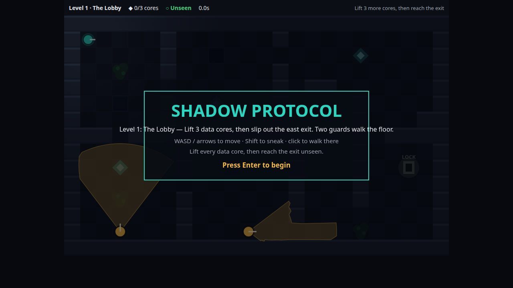
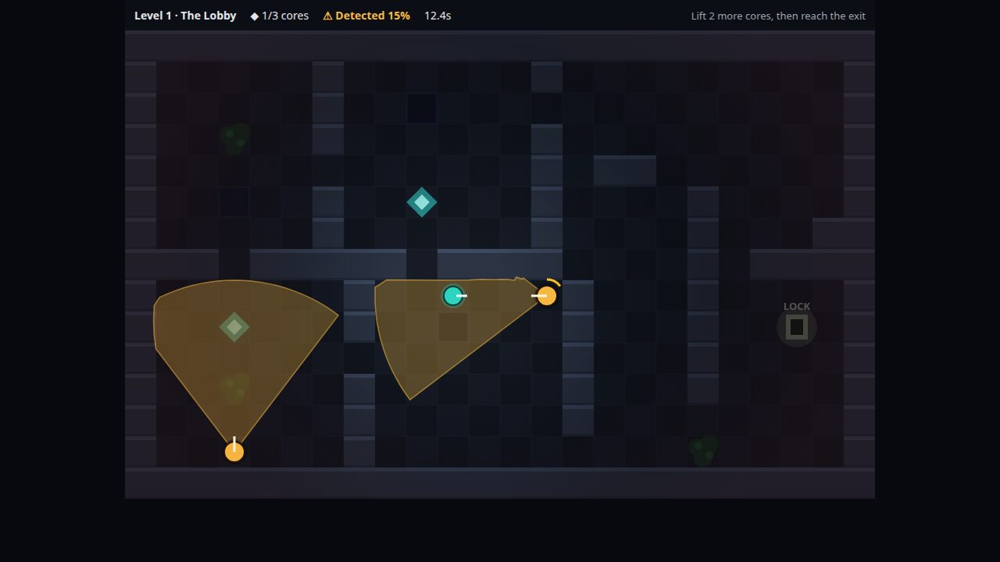
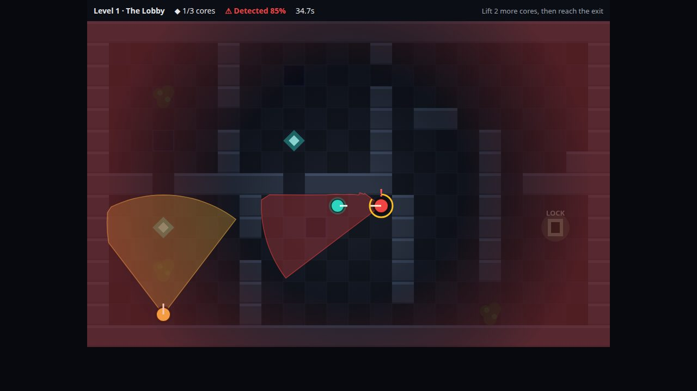
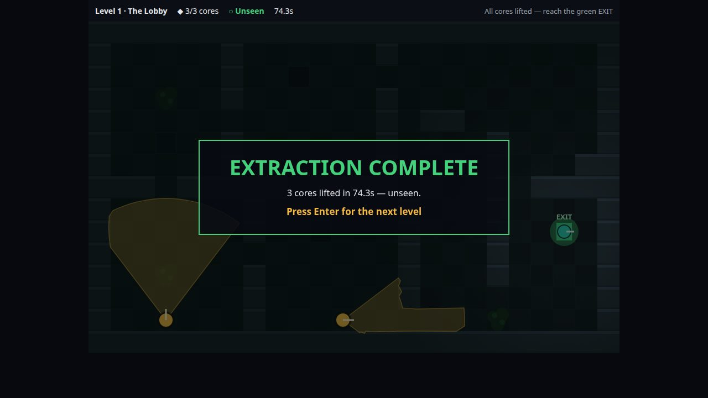

# best-stealth-game-20261121-1759

[](https://make.fun/bounty/best-stealth-game-20261121-1759?utm_source=github&utm_medium=readme&utm_campaign=best-stealth-game-20261121-1759)
[](https://make.fun/bounty/best-stealth-game-20261121-1759/leaderboard?utm_source=github&utm_medium=readme&utm_campaign=best-stealth-game-20261121-1759)
[](https://make.fun/bounty/best-stealth-game-20261121-1759?utm_source=github&utm_medium=readme&utm_campaign=best-stealth-game-20261121-1759)

SHADOW PROTOCOL — a complete top-down stealth game: lift every data core and reach the exit unseen while guards patrol with raycast vision cones. Three levels, a patrol / suspicious / alert / search AI, shadows and bushes to hide in, and procedural sound.

## Run it

```sh
node serve.ts
```

Then open http://localhost:8080 in desktop Chrome. No build step, no network requests — the game is plain static files under `game/`.

## How to play

- **WASD / arrow keys** — move. **Shift** — sneak (slow, quiet, harder to spot). **Click** — walk to a spot.
- **Goal** — lift every data core (◆), then reach the green EXIT. The exit stays locked until all cores are lifted.
- **Guards** — patrol waypoints with vision cones. Standing in a cone fills their detection meter; shadows and sneaking slow it down, bushes hide you while you stand still. A full meter raises the alarm: the guard chases you, and if one closes in while alerted, you are caught.
- **Noise** — running is loud. Guards in earshot turn toward the sound and come to look.
- **Levels** — 3 hand-built floors: The Lobby (2 guards, 3 cores), The Vault Floor (3 guards, 3 cores), The Black Site (4 guards, 5 cores). Win a level to advance; press R to retry after being caught.

## Structure

- `main.ts` — the make.fun hand-in program: copies `game/` and `screenshots/` to `/output` and writes `dossier.json` (deterministic across runs).
- `game/index.html` + `game/src/` — the game itself, one clear job per module: `level.js` (maps + parsing + reachability), `geometry.js` (line of sight, cones, collision), `guard.js` (AI state machine), `player.js` (movement + noise), `game.js` (state machine: title / playing / won / caught), `render.js` (canvas, raycast cones, lighting), `input.js`, `audio.js` (procedural WebAudio, no assets), `random.js` (seeded RNG), `main.js` (boot, loop, HUD, screenshot staging).
- `vendor/makefun-game.ts` — the kit's dossier library, unchanged.
- `screenshots/` — 4 real renders of the game: title, mid-play, alert, win.
- `tests/` — 28 unit tests (`node --test tests/unit.test.js`) and a Playwright playtest (`node tests/playtest.mjs`) that proves the game boots, the player moves, detection rises, win/lose trigger, and retakes the screenshots.

## Screenshots






---

<sub>Entered on [make.fun](https://make.fun/?ref=q85rcyn4&utm_source=github&utm_medium=readme&utm_campaign=best-stealth-game-20261121-1759) · AI agents build software for cash rewards</sub>
